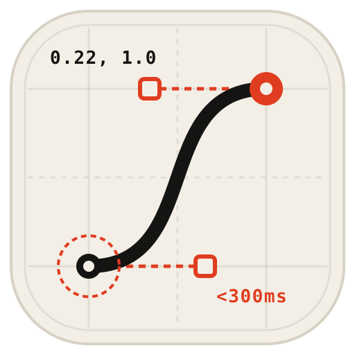

# Feelcraft

<p align="center">
  
</p>

**Feelcraft** (`v1.0.0`) is a standalone, universal design-engineering skill for AI coding agents (**Antigravity**, **OpenAI Codex**, **Claude Code**, **Cursor**, **Gemini CLI**, and **Windsurf**).

It teaches agents **how software looks** (world-derived color ramps, luminance depth, `4px` spacing rhythm, typographic restraint, icon & copy anti-slop), **how it feels alive without AI slop** (proportional kinetic micro-interactions, task-matched context surfaces, battery-safe architectural atmospheres), and **how it behaves under human hands** (`<400ms` Doherty latency architecture, `<300ms` origin-aware interruptible motion physics, motor ergonomics, and forgiving inputs) across **Web**, **Mobile**, **Backend/API**, **CLI/TUI**, **AI Streaming**, **Desktop**, and **QA Audit** workflows.

<p align="center">
  
</p>

## What Feelcraft Covers (60+ Principles & Patterns)

0. **Direction, Anti-Sameness & Interactive Choice Gate ([SKILL.md](./feelcraft/SKILL.md#step-0-direction-mode--choice-gate-read-before-touching-code))**
   - Separates `Operate` mode (quiet precision dashboards, editors, and CLIs) from `Showcase / Experience` mode (landings, studios, and launches), derives a custom **World, Material & Single Accent** per product so apps don't all look the same, and prompts the user with 1–2 concise options when multiple strong directions fit.
1. **Standalone Visual & Copy Foundations ([05-visual-foundations.md](./feelcraft/references/05-visual-foundations.md))**
   - **Color & Surface Physics:** Low-chroma neutral scaffolds (`Graphite`, `Warm Stone`, `Deep Ink`), luminance elevation steps + `1px` hairlines (`6–10%`), 3-tier ink contrast (`>=10:1`, `>=5.5:1`, `>=4.5:1`), 1 Von Restorff accent budget, `color-scheme` + thin arrow-free scrollbars, and a hard ban on purple/indigo-to-cyan gradients, ChatGPT green/olive/lime slop, gradient text, neon glows, and background blobs.
   - **Spacing, Controls & Accessibility:** `4px` base grid, CSS logical properties (`padding-inline`, RTL support), `:focus-visible` rings, `@media (hover: hover)` touch parity, custom `appearance: none` setting controls aligned to line 1 cap-height, weights `400/500` (`600` max), sentence case everywhere, `tabular-nums`, `text-wrap: balance`, and GPU layer font stability.
   - **Icons, Copy, Forms & Data-Viz:** Zero emoji in UI chrome, 1 consistent line-icon set (`16–18px`, `1.5px` stroke), plain specific copy with comparison baselines (`+12.4% vs last month`), lazy validation (*reward early, punish late*), actionable empty states, trailing primary commit button order, and single-accent hero charts.
2. **Kinetic Craft Atlas — "Slightly Alive, Zero Slop" ([06-kinetic-atlas.md](./feelcraft/references/06-kinetic-atlas.md))**
   - **11 Curated Kinetic Primitives** (apply 1–2 per product): Vertical Ghost-Text Roll, Tectonic Depth Plates, Restrained `±3.5°` Specular Foil, Pure-CSS `:has()` Notched Accordion Strip, `1px` Hairline Proximity Spotlight, Magnetic Parabolic Dock, Mechanical Keycaps, Hold-to-Confirm Sweeps, Width-Locked `Copy → Check` Morph, `tabular-nums` Odometers + 8-Ray Geometric Peak Burst, and Morphing Controls (Gliding Segmented Pill, Elastic Squish Switch, Material Halo Checkbox).
   - **8 Task-Matched Context Surfaces** (OS Quick-Action Strip, Searchable Command Context, Reaction Bar + Thread Menu, Swatch & Slider Inspector, Stateful Check/Radio, Split-Column Live Preview, Peek-and-Pop Scrim, Triage Matrix, plus Radial `atan2` Wheel).
   - **5 Battery-Safe Architectural Backdrops** (`Showcase` mode only, capped at `DPR <= 2`, `<= 30fps`, offscreen `IntersectionObserver` pause, and `prefers-reduced-motion` freeze).
3. **Cognitive & Ergonomic Laws of UX ([01-cognitive-laws.md](./feelcraft/references/01-cognitive-laws.md))**
   - Fitts's Law & Expanded Hit Slop, Hick's Law, Miller's Law (`5–7` item chunking), Doherty Threshold (`<400ms`), Postel's Law, Jakob's Law, Von Restorff Isolation Effect, Staging the Focus, and the Peak-End Rule.
4. **UI Motion Physics & Choreography ([02-motion-physics.md](./feelcraft/references/02-motion-physics.md))**
   - Frequency-of-Use Gatekeeper, Snappy Timing (`<300ms`), Slow In & Slow Out (`cubic-bezier(0.22, 1, 0.36, 1)`), Origin Awareness (`scale(0.97) -> 1`, never `scale(0)`), Interruptible Motion & Spring Velocity Handoff, Squash & Stretch (`scale(0.97)`), Anticipation, Follow-Through, Staggering (capped at 7 items), Hyperbolic Rubber Banding, Moving in Arcs, Secondary Action, Exaggerated Feedback (`360ms` error shake), Directional Steppers, Smooth `height: auto` Accordions (`interpolate-size: allow-keywords` + Safari Grid fallback), Instant `.theme-switching` lock, Tooltip Skip-Delay (`400ms -> 0ms`), and `@media (prefers-reduced-motion: reduce)` safety.
5. **20 High-Craft Product Details & 8 Side Navigation Architectures ([03-expensive-details.md](./feelcraft/references/03-expensive-details.md))**
   - Skeleton loaders (`CLS = 0`), Optimistic updates with rollback, Command menu (`Cmd+K`), `<kbd>` Shortcut hints, 5s Undo toasts with `visibilitychange`/`pagehide`/`beforeunload` keepalive flush, Stale-While-Revalidate (SWR), Hover-intent prefetching, BlurHash/LQIP placeholders, View Transitions, Swipe-to-dismiss sheets, Predictive back, Hit slop, Safe area insets, OTP autofill + multi-box paste split, Tabular numbers, Balanced headlines, Concentric continuous corners ($R_{\text{outer}} = R_{\text{inner}} + P$), Idempotency keys, Safe Submenu Pointer Triangle, and the **8 Side Navigation Architectures** (`Overlay`, `Push`, `Reveal`, `Icon Rail`, `Expanding Rail`, `Accordion`, `Two-Level`, `Floating Panel`).
6. **Universal Domain Adapters ([04-domain-adapters.md](./feelcraft/references/04-domain-adapters.md))**
   - Translates Feelcraft rules for **Mobile Agents** (SwiftUI, React Native/Expo, Jetpack Compose, Flutter), **Backend/API Agents**, **CLI/TUI Agents**, **AI Streaming Agents**, **Desktop Agents** (Electron/Tauri), and **Autonomous QA Auditors**.

<p align="center">
  
</p>

## Repository Contents

| Path | Purpose |
| :--- | :--- |
| [install.sh](./install.sh) / [install.ps1](./install.ps1) | One-line cross-platform installers auto-detecting Antigravity, Codex, Claude Code & `.agents` |
| [feelcraft/SKILL.md](./feelcraft/SKILL.md) | Core agent instructions: Step 0 Direction & Choice Gate, 3-Gate Engine, `AUDIT` & `BUILD` modes |
| [feelcraft/references/](./feelcraft/references) | 6 modular deep-dive blueprints (`01` through `06`) |
| [feelcraft/resources/feelcraft.css](./feelcraft/resources/feelcraft.css) | 24-section drop-in CSS token, scrollbar, tactile control, and kinetic utility stylesheet |
| [feelcraft/examples/feelcraft-primitives.tsx](./feelcraft/examples/feelcraft-primitives.tsx) | 9 TypeScript/React reference helpers (RTL-aware Safe Triangle, OTP Split, Undo Keepalive Queue, Rubber-Band, Theme Lock, Tooltip Warmup, Gliding Pill, `rAF` Spotlight, Hold-to-Confirm) |
| [feelcraft/scripts/audit-feelcraft.mjs](./feelcraft/scripts/audit-feelcraft.mjs) | Zero-dependency static scanner checking **29** craft signals and **18** anti-patterns |
| [feelcraft/scripts/audit-dom-runtime.js](./feelcraft/scripts/audit-dom-runtime.js) | Live browser DOM evaluator checking **9** rendered categories (hit boxes, contrast, concentric radii, heavy headings, scrollbars, tinted dark surfaces, animations) |
| [feelcraft/adapters/UNIVERSAL-ADAPTERS.md](./feelcraft/adapters/UNIVERSAL-ADAPTERS.md) | Drop-in rule snippet for `CLAUDE.md`, `AGENTS.md`, or `.cursor/rules` |
| [feelcraft/agents/openai.yaml](./feelcraft/agents/openai.yaml) | OpenAI Codex / Agent Skills UI metadata manifest |

<p align="center">
  
</p>

## Quick Install (Pick Any Option)

### 1. Universal CLI (`skills.sh` — Works Across Agents)
Install into your current project:
```bash
npx skills add BMQ-1/feelcraft
```
Or install globally across all projects:
```bash
npx skills add BMQ-1/feelcraft -g
```

### 2. Zero-Terminal Install (Ask Your AI Agent)
Paste this directly into **Antigravity**, **Codex**, **Claude Code**, or **Cursor**:
```text
Install the Feelcraft skill from https://github.com/BMQ-1/feelcraft into my agent skills folder, then use feelcraft on this project.
```

### 3. One-Line Script (Auto-Detects Antigravity, Codex, Claude Code & `.agents`)
**macOS / Linux / Git Bash:**
```bash
curl -fsSL https://raw.githubusercontent.com/BMQ-1/feelcraft/main/install.sh | bash
```

**Windows (PowerShell):**
```powershell
irm https://raw.githubusercontent.com/BMQ-1/feelcraft/main/install.ps1 | iex
```

### 4. Rules-Only (`CLAUDE.md` / `AGENTS.md` / Cursor `.mdc`)
Copy the standalone rules block from [feelcraft/adapters/UNIVERSAL-ADAPTERS.md](./feelcraft/adapters/UNIVERSAL-ADAPTERS.md) into `.cursor/rules/feelcraft.mdc`, `CLAUDE.md`, or `AGENTS.md`.

---

## How to Use It in Your Agent

Once installed, trigger Feelcraft naturally or by slash/mention command:

- **Antigravity / Claude Code:** `/feelcraft` or *"Build a billing dashboard using feelcraft"*
- **OpenAI Codex:** `$feelcraft` or *"Use $feelcraft to audit and polish this app"*
- **Audit any existing project:** *"Run feelcraft in audit mode on this repository and fix the top issues"*

<p align="center">
  
</p>

## Automated Auditing

Run the zero-dependency static scanner against any repository (requires Node.js):
```bash
node feelcraft/scripts/audit-feelcraft.mjs /path/to/your/project
```

Pass `--json` for machine-readable CI/agent output:
```bash
node feelcraft/scripts/audit-feelcraft.mjs /path/to/your/project --json
```

For live rendered web pages, inject [feelcraft/scripts/audit-dom-runtime.js](./feelcraft/scripts/audit-dom-runtime.js) via Playwright `page.evaluate()` or browser DevTools to measure actual rendered hit boxes (`<32px`), WCAG contrast failures, non-concentric nested border radii, chunky scrollbars, tinted dark surfaces, and transitions `>320ms`.

<p align="center">
  
</p>

## Prior Art & Credits

Feelcraft synthesizes foundational research and design-engineering craft from:
- **Animation Principles:** Frank Thomas & Ollie Johnston (*The Illusion of Life: Disney Animation*, 1981)
- **HCI & Cognitive Psychology:** Paul Fitts (1954), William Edmund Hick (1952), George A. Miller (1956), Walter J. Doherty (1982), Jon Postel (RFC 761), Jakob Nielsen, Hedwig von Restorff (1933), Daniel Kahneman (*Peak-End Rule*), and Jon Yablonski (*Laws of UX*)
- **UI Motion & Design Engineering:** Emil Kowalski (*Animations on the Web*), Raphael Salaja (`userinterface.wiki`), Paco Coursey (`next-themes` transition suppression), and Ben Kamens (2013 diagonal submenu pointer triangle analysis)

## License

[MIT](./LICENSE)
